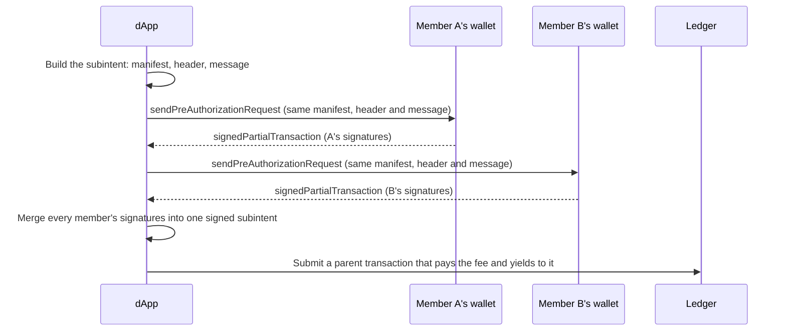

# Shared control: dApp integration guide

How a dApp can let several Radix Wallet users jointly change who controls a
shared account (a DAO treasury, a team or family account), and what the
wallet accepts.

An account or persona under shared control is held by an **access
controller** whose roles name several people's keys. Changing its rules,
locking it or cancelling a change are access controller calls. No member can
make them alone, so each member approves their share with a
**pre-authorization** (a signed subintent). The dApp collects the approvals
and submits them in one transaction.

> The wallet only signs access controller calls in pre-authorizations, and
> only when the user **can't** pass any role alone. A transaction request
> calling an access controller, or a pre-authorization that would let one user
> act on their own, is rejected.

## Flow



1. **Fix the subintent.** The dApp chooses the manifest, the header and the
   message once. Every member must sign the **same subintent hash**, so every
   request carries exactly these three.
2. **Request each member's approval** with a pre-authorization request. Each
   wallet reviews the change and returns a `SignedPartialTransactionV2`
   holding its user's signatures.
3. **Merge the signatures.** Take one returned signed partial transaction and
   append the other members' `root_subintent_signatures`. Members who don't
   use the Radix Wallet can sign the same hash with their own keys.
4. **Submit** a parent transaction intent that locks the fee and yields to
   the subintent. The ledger checks the access controller's roles against
   all the signatures combined.

## Supported operations

The manifest must fall into exactly one of these classes, on every access
controller it calls. The calls listed are the only ones allowed on each
access controller, in the order given.

| Class | Calls per access controller | Effect |
|---|---|---|
| **Recovery** | `initiate_recovery_as_primary` then `quick_confirm_primary_role_recovery_proposal`, or `initiate_recovery_as_recovery` then `quick_confirm_recovery_role_recovery_proposal`; the confirmation names the same rules and delay | Rules replaced in one transaction |
| **Timed recovery** | `initiate_recovery_as_recovery`, optionally with `lock_primary_role` before or after it | Confirmable by anyone once the access controller's delay has passed, or quickly by another role |
| **Confirm recovery** | one `quick_confirm_{primary,recovery}_role_recovery_proposal` or `timed_confirm_recovery` | Pending proposal enacted |
| **Cancel recovery** | any of `stop_timed_recovery`, `cancel_primary_role_recovery_proposal`, `cancel_recovery_role_recovery_proposal`, `unlock_primary_role`, each at most once and in any order, with at least a stop or a cancel; a stop must come before cancelling the recovery role's proposal | Proposal stopped and/or cancelled |
| **Primary role lock** | one `lock_primary_role` or `unlock_primary_role` | Primary role locked or unlocked |

Several access controllers may be called in one subintent, as long as each
follows the same class.

**Not supported in pre-authorizations:**

- recovery fee vault calls (`contribute_recovery_fee`, `withdraw_recovery_fee`);
- `create_proof`, badge withdraw attempts, or any other access controller method;
- mixing access controller calls with anything else, including `lock_fee`.

## Rules the wallet enforces

Every rejection reaches the dApp as a failed request. The wallet doesn't say
which rule failed. iOS currently reports it as `failedToPrepareTransaction`
and Android as `invalidRequest`.

| Rule | What it means for the manifest |
|---|---|
| **Enclosed subintent** | First instruction `ASSERT_WORKTOP_IS_EMPTY`, last `YIELD_TO_PARENT` with no arguments, and no other yield. It takes nothing from the parent and returns nothing. |
| **Access controller calls only** | Only the calls of one class above. No fee lock: the parent pays. |
| **Static addresses** | Each access controller is an existing on-ledger address. Proposed rules name resources and badges by static address. |
| **No account or persona authorization** | Nothing in the subintent may require an account's or persona's own authorization, e.g. no withdraws or proofs from any account. |
| **One controlled entity** | Each access controller called holds the owner badge of exactly one account or persona. It doesn't have to be in the member's wallet. |
| **Shared, not solo** | The user's keys alone pass **no** role of any access controller called, checked against the current on-ledger rules, before review and again at signing. |
| **Each holder once per group** | Proposed or confirmed rules may not count one holder twice in a group, e.g. "2 of [A, A, B]", or "all of (A or B) and (A or C)". Such a group looks shared but A passes it alone. Stopping or cancelling is never rejected for this. |

### Which keys the wallet signs with

The wallet signs with the user's **MFA signature resources** only: the
signature badges shown under a factor's *MFA Signature Resources* in the
wallet. To make a user a member, put that badge (a signature resource
`NonFungibleGlobalId`) into the access controller's roles. There's no wallet
request that returns it, so the user has to share it with the dApp.

For each access controller, the wallet signs for the roles the calls need.
When a call accepts several roles, it signs for every one the user is in:

| Class | Roles the wallet signs for |
|---|---|
| Recovery | all three roles |
| Timed recovery (with or without lock) | recovery |
| Confirm recovery, quick | the two roles other than the proposer |
| Confirm recovery, timed | none; anyone may confirm, so you don't need the wallet |
| Cancel recovery | a stop alone: all roles; with a cancel or unlock: the roles those need (the proposer's role to cancel, recovery to unlock) |
| Primary role lock | recovery |

If none of the user's keys is in a role a call needs, signing fails rather
than return an unsigned subintent.

## The request

Use the Radix dApp Toolkit with `SubintentRequestBuilder().header()` (2.3.0
has it) and pass the header you fixed:

```ts
import { SubintentRequestBuilder } from '@radixdlt/radix-dapp-toolkit'

const result = await rdt.walletApi.sendPreAuthorizationRequest(
  SubintentRequestBuilder()
    .manifest(manifest)                 // the same string for every member
    .header({
      networkId: 2,                     // Stokenet; required by the wallet
      startEpochInclusive: epoch,
      endEpochExclusive: epoch + 10,
      maxProposerTimestampExclusive: expiresAt, // unix seconds; required
      intentDiscriminator,              // random, below 2^53
    })
    .setExpiration('atTime', expiresAt) // required; keep it equal to the header's expiry
    .message('Rotate council key'),     // optional, but the same for every member
)

if (result.isOk()) {
  const { signedPartialTransaction, subintentHash, expirationTimestamp } = result.value
}
```

**Same subintent for every member.** Everything below changes the subintent
hash. If any of it differs between members, their signatures won't combine.

- `manifest`: the same text, so it compiles to the same instructions, and the
  same blobs. The wallet doesn't alter either.
- `message`: the same value, or omitted for everyone.
- `header`: the same object. Always set `networkId` and
  `maxProposerTimestampExclusive`. Keep `intentDiscriminator` below 2^53 so it
  survives as a JavaScript number.
- The wallet signs your header as it is. It doesn't check it against its
  network or the request's expiration, and its review shows the request's
  expiration, so keep them consistent.

Without a header, each wallet picks its own epochs and discriminator. That
works for a single signer, but members' signatures then cover different
hashes.

## Manifest examples

Lock the primary role (Primary role lock class):

```
ASSERT_WORKTOP_IS_EMPTY;
CALL_METHOD
    Address("accesscontroller_tdx_2_1c...")
    "lock_primary_role"
;
YIELD_TO_PARENT;
```

Stop a timed recovery, cancel it and unlock the primary role (Cancel
recovery class). `stop_timed_recovery` takes the proposal it stops, exactly
as it was proposed:

```
ASSERT_WORKTOP_IS_EMPTY;
CALL_METHOD
    Address("accesscontroller_tdx_2_1c...")
    "stop_timed_recovery"
    Tuple(<primary rule>, <recovery rule>, <confirmation rule>)
    Enum<1u8>(20160u32)
;
CALL_METHOD
    Address("accesscontroller_tdx_2_1c...")
    "cancel_recovery_role_recovery_proposal"
;
CALL_METHOD
    Address("accesscontroller_tdx_2_1c...")
    "unlock_primary_role"
;
YIELD_TO_PARENT;
```

A rule that requires any 2 of 3 keys:

```
Enum<2u8>(              # AccessRule::Protected
  Enum<0u8>(            # CompositeRequirement::BasicRequirement
    Enum<2u8>(          # BasicRequirement::CountOf
      2u8,
      Array<Enum>(
        Enum<0u8>(NonFungibleGlobalId("resource_tdx_2_1nfxxxxxxxxxxed25sgxxxxxxxxx002236757237xxxxxxxxx3e2cpa:[<key hash A>]")),
        Enum<0u8>(NonFungibleGlobalId("resource_tdx_2_1nfxxxxxxxxxxed25sgxxxxxxxxx002236757237xxxxxxxxx3e2cpa:[<key hash B>]")),
        Enum<0u8>(NonFungibleGlobalId("resource_tdx_2_1nfxxxxxxxxxxed25sgxxxxxxxxx002236757237xxxxxxxxx3e2cpa:[<key hash C>]"))
      )
    )
  )
)
```

## Submitting

The parent transaction pays the fee and yields to the signed subintent:

```
USE_CHILD NamedIntent("change") Intent("subtxid_...");
CALL_METHOD Address("<fee payer>") "lock_fee" Decimal("10");
YIELD_TO_CHILD NamedIntent("change");
```

Before building it, append every other member's signature over the subintent
hash to the signed partial transaction's `root_subintent_signatures`. The
dApp may leave out signatures a role doesn't need. Submit before the
header's `endEpochExclusive` and `maxProposerTimestampExclusive`. Each wallet watches the
subintent's status and reports it once committed, which the toolkit passes
to `onSubmittedSuccess`.

## What the user sees

The wallet shows each access controller with the account it controls, what
the subintent does to it (proposes, confirms, stops, cancels, locks,
unlocks), and the rules it proposes or confirms, role by role. The user's
own keys are marked, keys in the user's address book show their names, and
other keys are flagged as unknown. So it helps to tell members to add their
co-signers' keys to their address book.

For changes, the wallet shows the access controller's **current** timed
recovery delay, which is the one the engine keeps. The delay named in a
proposal isn't applied.

## Limits

- Proposed rules nested 4 or more levels deep can't be previewed, so they
  can't be reviewed.
- The review shows the proposed rules, not a diff against the current ones.
- A cancellation doesn't name the proposal it cancels: it's whichever is
  pending when the transaction runs.
- Creating a shared account (accounts or personas under new access
  controllers) isn't supported in pre-authorizations. Send it as a regular
  transaction; the same "each holder once" rule applies to its rules.

## Testing

Test on Stokenet first. A dApp served from `localhost` has no verifiable dApp
definition, so turn on **Settings → Preferences → Developer Mode** in the
wallet.

The design and security model behind this guide are in
[shared-control-pre-authorization.md](shared-control-pre-authorization.md).
