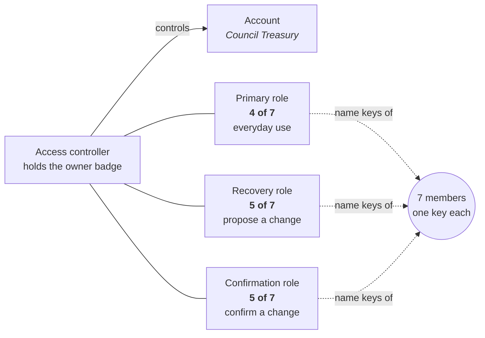
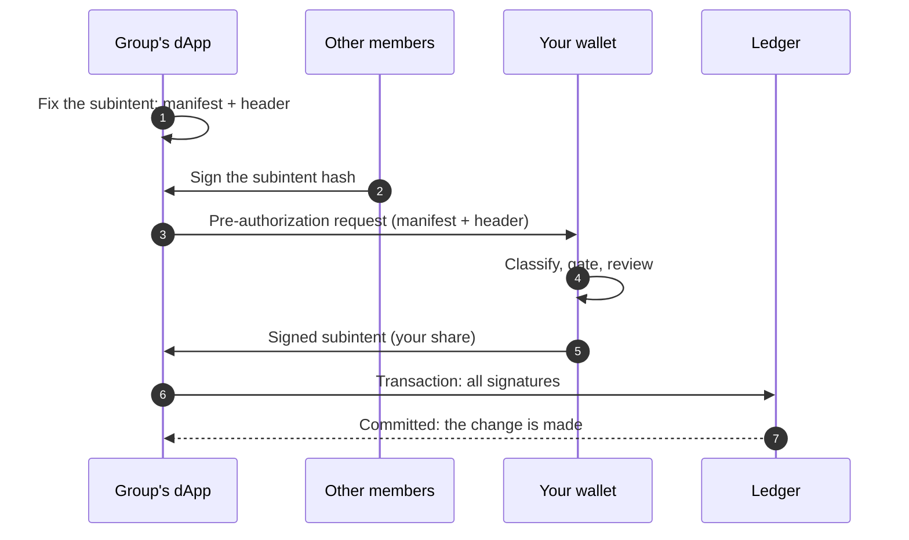
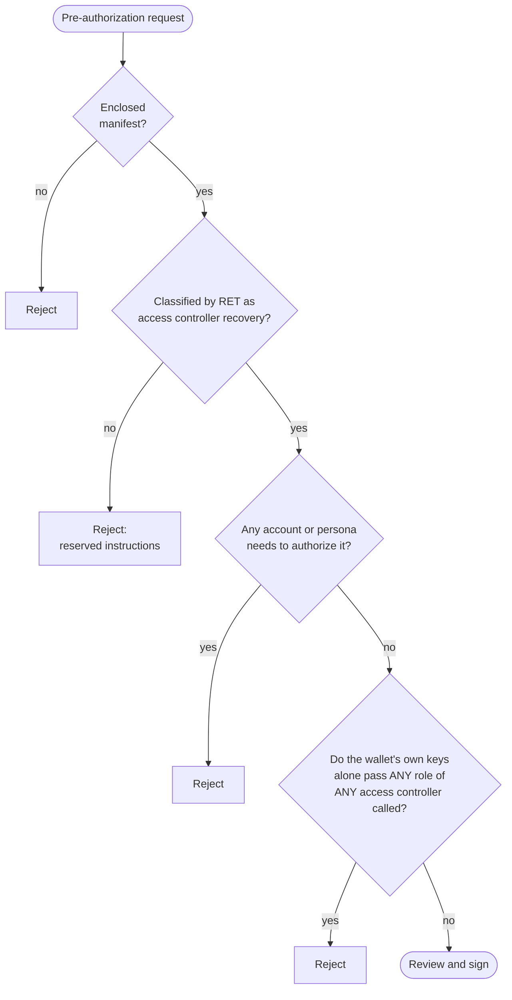
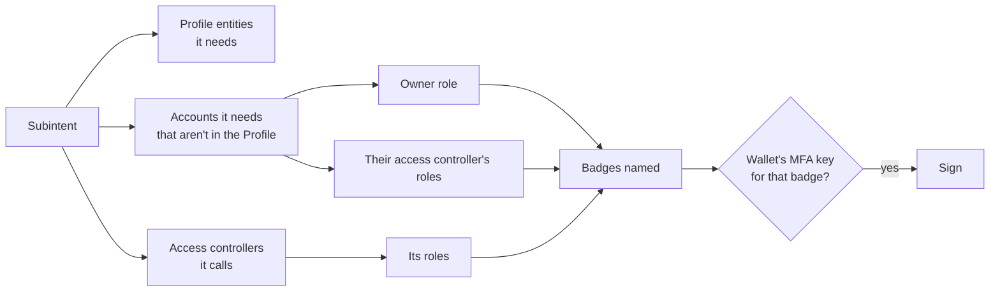
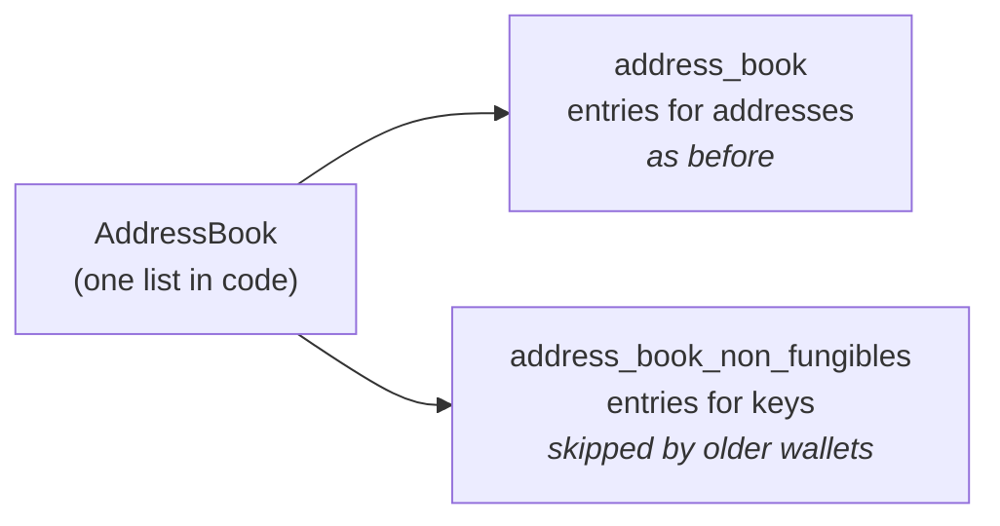

# Shared control through pre-authorizations

How the wallet lets a user take part in changing who controls an account they
control **together with others**, and why it is safe to do so.

An account can hand its owner badge to an **access controller**. The access
controller then holds the account, and its three roles say who may do what.
When the roles name keys of several people, the account is under shared
control: a DAO treasury, a family account, a team wallet.

Changing the rules (adding or removing a member, changing a threshold) is,
on the access controller, a *recovery*: a role proposes new rules and they
take effect once confirmed. The user-facing wording calls it a **change**.

## The flow

No member holds enough keys to act alone. Each approves their share with a
**pre-authorization** (a signed subintent), and the group's dApp combines them
into one transaction.

Because the dApp fixes the header, every member signs the **same** subintent
hash, so approvals can be collected before or after yours. The wallet must
therefore not alter the subintent: rebuilding a manifest now keeps its blobs
exactly as they are (it used to add an empty blob, which changed the hash).

A subintent can both **propose and confirm** the change: the approvals that
pass the recovery role (5 of 7) also pass the primary role (4 of 7), which may
quick-confirm a recovery-role proposal. The change is then made in one
transaction.

## Security model

Access controller methods are **reserved instructions**: a dApp must never be
able to make a wallet hand over an account. The radix-engine-toolkit keeps
them reserved; Sargon allows them **only in pre-authorizations**, and only
when all of these hold:

| Rule | Why |
|---|---|
| **Enclosed** | The subintent takes nothing from its parent, so the wallet can preview it alone, and what the user reviews is all it does. |
| **Classified** | RET's classifier is a strict allowlist: the manifest contains access controller recovery calls and nothing else. Sargon relies on it rather than re-checking instructions. |
| **No account or persona authorizes it** | The only authority the user adds is the keys below. A dApp can't bundle the call with anything that spends from or acts as the user's own entities. |
| **The user's keys alone pass no role** | A pre-authorization is by definition **shared** signing. If the user could pass a role alone, the call would act on an access controller they control alone, and a malicious dApp could get them to give up their own account. This is checked against every role (not only the ones the calls need), with the controllers' current rules read from the ledger. An access controller whose rules can't be read counts as passed, so the request is rejected. |

The keys the wallet signs with are, for now, **only its MFA factor
instances**, so the last check compares those keys' badges with each role.
These rules are deliberately strict; they can be relaxed once the need is
clear, and other access controller operations (stop timed recovery, lock the
primary role, …) can be allowed case by case.

Whether the controlled account is in the user's Profile doesn't matter: a
shared account can be there too (e.g. after MFA rediscovery), so ownership is
judged by the rules, not by the Profile.

## What the wallet signs with

The rules come from one place, `fetch_access_controllers_details`, which
reads an access controller's current rules (from its role assignments) and
the entity it controls (the owner badge in its vault) in the same Gateway
call.

## What the user reviews

The review shows the **proposed rules**, role by role, in the grammar of
`AccessRequirementForDisplay`: "Any 4 of these 7", "All of these", ways
joined by OR, parts by AND.

- The controlled account, read from the ledger.
- The user's own factor, recognised by its badge.
- Every other key by its **address book name**, if the user gave it one.
  The address book can now name non-fungibles, so a co-signer's key reads
  "Bob". A key without a name stands out.
- The emergency fallback: the time after which a proposed change can be
  completed without the confirmation role.

Address book entries for non-fungibles are stored in a list of their own, so
older wallets still load the Profile:

## Known limits

- The review shows the proposed rules, not a comparison with the current
  ones; a lowered threshold isn't called out.
- The proposal doesn't say whether it is also confirmed in the same
  transaction.
- The Gateway's preview fails for proposed rules nested 4 or more levels
  deep, so such proposals can't be reviewed.
- A dApp-supplied header without `max_proposer_timestamp_exclusive` makes
  `WalletToDappInteractionSubintentResponseItem::from` panic; it should be an
  error.
- Depends on the RET classification of enclosed access controller
  subintents, not yet merged upstream.
