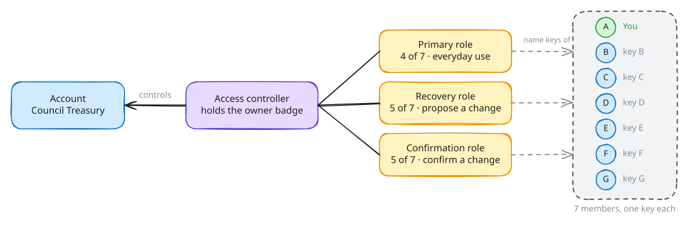
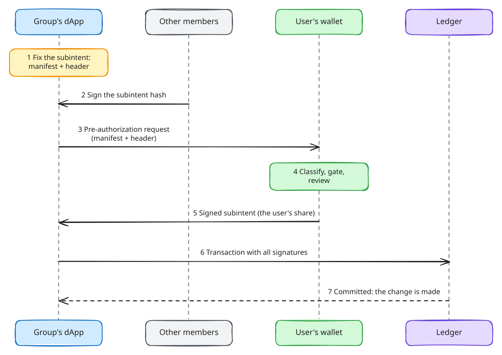
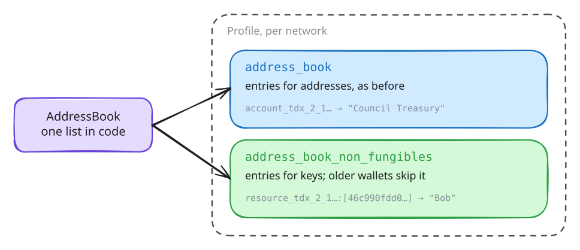

# Shared control through pre-authorizations

How the wallet lets a user take part in changing who controls an account they
control **together with others**, and why it is safe to do so.

An account can hand its owner badge to an **access controller**. The access
controller then holds the account, and its three roles say who may do what.
When the roles name keys of several people, the account is under shared
control: a DAO treasury, a family account, a team wallet. In the example
below, each role names a different group, and the user's key is in two of
them.

Changing the rules (adding or removing a member, changing a threshold) is,
on the access controller, a *recovery*: a role proposes new rules and they
take effect once confirmed. The user-facing wording calls it a **change**.

## The flow

No member holds enough keys to act alone. Each approves their share with a
**pre-authorization** (a signed subintent), and the group's dApp combines them
into one transaction.

Because the dApp fixes the header, every member signs the **same** subintent
hash, so approvals can be collected before or after the user's. The wallet must
therefore not alter the subintent: rebuilding a manifest now keeps its blobs
exactly as they are (it used to add an empty blob, which changed the hash).

A subintent can both **propose and confirm** the change (the Recovery class
below), so two groups must agree on it: the council proposes it with the
recovery role, and the operators confirm it with the primary role, which may
quick-confirm a recovery-role proposal (the guardians could instead, with the
confirmation role). Here Dave signs for the council, Bob for the operators,
and the user's key counts in both, so the change is made in one transaction
once the three have signed. The user alone passes neither role.

## Security model

Access controller methods are **reserved instructions**: a dApp must never be
able to make a wallet hand over an account. The radix-engine-toolkit keeps
them reserved; Sargon allows them **only in pre-authorizations** whose only
reserved instructions are access controller calls, and only when all of these
hold:

| Rule | Why |
|---|---|
| **Enclosed** | The subintent takes nothing from its parent, so the wallet can preview it alone, and what the user reviews is all it does. |
| **Classified** | RET's classifiers are strict allowlists, and the manifest must be of one of the access controller classes below. Each requires exact calls on every access controller and nothing else besides: a subintent may not even pay the fee, and may only yield to its parent at the end. Sargon relies on them rather than re-checking instructions. |
| **No account or persona authorizes it** | The only authority the user adds is the keys of the next check. A dApp can't bundle the call with anything that spends from or acts as the user's own entities. |
| **The user's keys alone pass no role** | A pre-authorization is by definition **shared** signing. If the user could pass a role alone, the call would act on an access controller they control alone, and a malicious dApp could get them to give up their own account. This is checked against every role (not only the ones the calls need), with the controllers' current rules read from the ledger. An access controller whose rules can't be read counts as passed, so the request is rejected. |

The rules a pre-authorization proposes or confirms must also **name each
holder once per group**. The engine counts every entry of a list, so "any 2
of these 3" with one key listed twice is passed by that key alone, while it
reads as shared. The same goes for the same factor of the user twice, and for
a resource next to one of its own non-fungibles or amounts. Such rules are
rejected, as no rule that names each holder once needs them. Stopping or
cancelling a proposal is never rejected for the rules it proposed.

Every rejection is the reserved instructions error.

The keys the wallet signs with are, for now, **only its MFA signing keys**
(its MFA factor instances), so the last check compares those keys' badges
with each role.

The classes a pre-authorization may be of, each showing all it does:

| Class | What it does on each access controller |
|---|---|
| Recovery | proposes rules and quick-confirms the same ones: the change is made |
| Timed recovery | the recovery role proposes rules, optionally locking the primary role; anyone can confirm them once the access controller's delay has passed |
| Confirm recovery | confirms a proposal already made, quickly or after the delay |
| Cancel recovery | stops a timed recovery and/or cancels proposals, optionally unlocking the primary role |
| Primary role lock | locks or unlocks the primary role |

Moving XRD out of an access controller's recovery fee vault isn't allowed: it
can deposit into any account, which needs no authorization of its own.

Whether the controlled account is in the user's Profile doesn't matter: a
shared account can be there too (e.g. after MFA rediscovery), so ownership is
judged by the rules, not by the Profile.

## What the wallet signs with

The wallet signs with its **MFA signing keys**: its MFA factor instances on
the network, each with the badge its signature proves. From these it takes
the keys the rules below name:

- **Profile entities** the subintent needs: their own factors, as in any
  transaction.
- **Accounts it needs that aren't in the Profile**: their owner role. If an
  access controller holds the owner badge, the wallet adds a `create_proof`
  on it, which needs its **primary role**, so the primary role's keys too.
- **Access controllers it calls**: only the roles its calls need, read from
  the classification the review showed. The host passes the reviewed
  execution summary to `sign_subintent`.

| Class | Roles signed for, per access controller |
|---|---|
| Recovery (proposed and confirmed at once) | every role: the proposing one, and either other for the confirmation |
| Timed recovery, with or without a lock | recovery |
| Confirm recovery, quickly | the two roles other than the proposing one |
| Confirm recovery, after the wait | none: anyone may, so nothing is signed |
| Cancel recovery | stopping alone: every role; with a cancel or an unlock, the role they need (the proposing role, recovery to unlock), which stops the timer too |
| Primary role lock | recovery |

So, per access controller: a role a call can only be made with is signed
for; a call that accepts any of several roles, such as a quick
confirmation, adds them all, as the wallet can't see which one the other
members complete; unless it accepts a role another call on the same access
controller requires, which completes it too. Every signature goes into the
subintent's one auth zone, so the members' signatures together pass
whichever role they complete, and the dApp may drop the ones it doesn't need
before submitting. Signing for a role that isn't used is harmless: the
signature only counts for this subintent, whose class allows nothing but
the reviewed calls, and the check above already counts every key.

Without a classification, e.g. a host that doesn't pass the summary yet,
the wallet signs with every role's keys, as before.

The review's preview can't pass these roles: it presents only the user's
keys, and the others sign later. So a pre-authorization that calls an access
controller, or needs an account or persona that isn't in the Profile, is
previewed with the Gateway's auth checks off. The preview shows what the
subintent does, while the ledger checks every role when it's submitted.

An access controller's rules come from one place, the same for signing and
for the check: `fetch_access_controllers_details`, which reads its current
rules (from its role assignments) and the entity it controls (the owner badge
in its vault) in one Gateway call. The review reads them once, both to show
the controlled account and the current delay and for the check; signing,
which comes later, reads them again. An account's owner role is read from
the account's own role assignments.

## What the user reviews

The review shows the **proposed rules**, role by role, as an
`AccessRequirementForDisplay`: requirements joined by any-of and all-of, and
"at least n of these keys", which the wallet draws as e.g. "Any 4 of these 7".

- The controlled account, read from the ledger.
- The user's own factor, recognised by its badge.
- Every other key by its **address book name**, if the user gave it one.
  The address book can now name non-fungibles, so a co-signer's key reads
  "Bob". A key without a name stands out.
- The emergency fallback (timed recovery): the time after which a change
  proposed with the recovery role can be completed without being confirmed.
  The engine doesn't apply the delay a proposal or a confirmation names: the
  access controller keeps the one it has. So every class that proposes or
  confirms rules also carries the access controller's current delay, read
  from the ledger, and that is the one to show.

Address book entries for non-fungibles are stored in a list of their own, so
older wallets still load the Profile:

## Known limits

- The review shows the proposed rules, not a comparison with the current
  ones; a lowered threshold isn't called out.
- A cancellation doesn't name the proposal it cancels: it's whichever is
  pending when the transaction runs, so the review has to read it from the
  ledger.
- The Gateway's preview fails for proposed rules nested 4 or more levels
  deep, so such proposals can't be reviewed.
- A dApp-supplied header without `max_proposer_timestamp_exclusive` makes
  `WalletToDappInteractionSubintentResponseItem::from` panic; it should be an
  error.
- Depends on RET's access controller classes, on the
  `ac_manifest_clasification_improved` branch, not yet merged upstream.
- When a call accepts several roles, the wallet signs for every one the
  user's keys are in: an extra prompt when those keys come from different
  factors, and the dApp learns they belong to the same person. An optional
  hint in the request, naming the role the group completes, would let the
  wallet narrow it; it isn't part of the request yet.
- The wallet's own access controller transactions have signing flows only
  for updating a shield and stopping a timed recovery. Locking or unlocking
  the primary role, cancelling without stopping, and quick-confirming a
  primary role's proposal would be signed with the wrong role; the wallet
  doesn't make them yet.
- Which role proposes and which may confirm is known in two places: the
  roles pre-authorizations sign for, and the role combinations of the
  shield update flow.

---

The diagrams are Excalidraw drawings saved as SVG with the scene embedded: to
change one, open the SVG in Excalidraw, edit it, and export it as SVG again
with "Embed scene" on.
