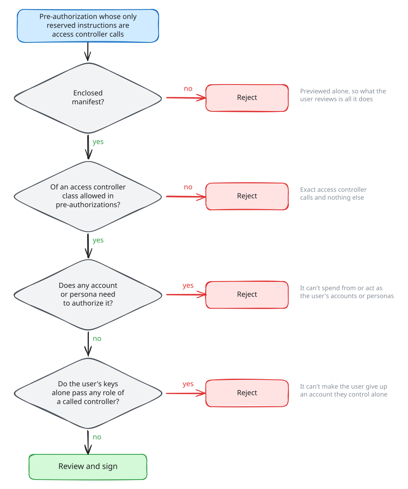
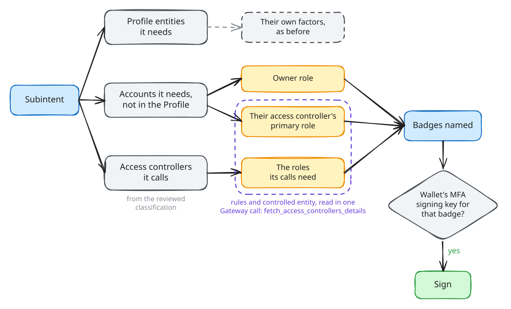

# Shared control through pre-authorizations

How the wallet lets a user take part in changing who controls an account they
control **together with others**, and why it is safe to do so.

An account can hand its owner badge to an **access controller**. The access
controller then holds the account, and its three roles say who may do what.
When the roles name keys of several people, the account is under shared
control: a DAO treasury, a family account, a team wallet.

Changing the rules (adding or removing a member, changing a threshold) is,
on the access controller, a *recovery*: a role proposes new rules and they
take effect once confirmed. The user-facing wording calls it a **change**.

## The flow

No member holds enough keys to act alone. Each approves their share with a
**pre-authorization** (a signed subintent), and the group's dApp combines them
into one transaction.

Because the dApp fixes the header, every member signs the **same** subintent
hash, so approvals can be collected before or after the user's. The wallet must
therefore not alter the subintent: rebuilding a manifest now keeps its blobs
exactly as they are (it used to add an empty blob, which changed the hash).

A subintent can both **propose and confirm** the change. Here the roles name
the same seven keys, so the approvals that pass the recovery role (5 of 7) also
pass the primary role (4 of 7), which may quick-confirm a recovery-role
proposal. The change is then made in one transaction.

## Security model

Access controller methods are **reserved instructions**: a dApp must never be
able to make a wallet hand over an account. The radix-engine-toolkit keeps
them reserved; Sargon allows them **only in pre-authorizations** whose only
reserved instructions are access controller calls, and only when all of these
hold:

| Rule | Why |
|---|---|
| **Enclosed** | The subintent takes nothing from its parent, so the wallet can preview it alone, and what the user reviews is all it does. |
| **Classified** | RET's classifiers are strict allowlists, and the manifest must be of one of the access controller classes below. Each requires exact calls on every access controller and nothing else besides: a subintent may not even pay the fee, and may only yield to its parent at the end. Sargon relies on them rather than re-checking instructions. |
| **No account or persona authorizes it** | The only authority the user adds is the keys of the next check. A dApp can't bundle the call with anything that spends from or acts as the user's own entities. |
| **The user's keys alone pass no role** | A pre-authorization is by definition **shared** signing. If the user could pass a role alone, the call would act on an access controller they control alone, and a malicious dApp could get them to give up their own account. This is checked against every role (not only the ones the calls need), with the controllers' current rules read from the ledger. An access controller whose rules can't be read counts as passed, so the request is rejected. |

The keys the wallet signs with are, for now, **only its MFA factor
instances**, so the last check compares those keys' badges with each role.

The classes a pre-authorization may be of, each showing all it does:

| Class | What it does on each access controller |
|---|---|
| Recovery | proposes rules and quick-confirms the same ones: the change is made |
| Timed recovery | the recovery role proposes rules, optionally locking the primary role; anyone can confirm them once the access controller's delay has passed |
| Confirm recovery | confirms a proposal already made, quickly or after the delay |
| Cancel recovery | stops a timed recovery and/or cancels proposals, optionally unlocking the primary role |
| Primary role lock | locks or unlocks the primary role |

Moving XRD out of an access controller's recovery fee vault isn't allowed: it
can deposit into any account, which needs no authorization of its own.

Whether the controlled account is in the user's Profile doesn't matter: a
shared account can be there too (e.g. after MFA rediscovery), so ownership is
judged by the rules, not by the Profile.

## What the wallet signs with

An access controller's rules come from one place, the same for signing and
for the gate: `fetch_access_controllers_details`, which reads its current
rules (from its role assignments) and the entity it controls (the owner badge
in its vault) in one Gateway call. An account's owner role is read from the
account's own role assignments.

## What the user reviews

The review shows the **proposed rules**, role by role, as an
`AccessRequirementForDisplay`: requirements joined by any-of and all-of, and
"at least n of these keys", which the wallet draws as e.g. "Any 4 of these 7".

- The controlled account, read from the ledger.
- The user's own factor, recognised by its badge.
- Every other key by its **address book name**, if the user gave it one.
  The address book can now name non-fungibles, so a co-signer's key reads
  "Bob". A key without a name stands out.
- The emergency fallback (timed recovery): the time after which a change
  proposed with the recovery role can be completed without being confirmed.
  The engine doesn't apply the delay a proposal names, so a timed recovery
  also carries the access controller's current delay, read from the ledger.

Address book entries for non-fungibles are stored in a list of their own, so
older wallets still load the Profile:

## Known limits

- The review shows the proposed rules, not a comparison with the current
  ones; a lowered threshold isn't called out.
- A cancellation doesn't name the proposal it cancels: it's whichever is
  pending when the transaction runs, so the review has to read it from the
  ledger.
- The Gateway's preview fails for proposed rules nested 4 or more levels
  deep, so such proposals can't be reviewed.
- A dApp-supplied header without `max_proposer_timestamp_exclusive` makes
  `WalletToDappInteractionSubintentResponseItem::from` panic; it should be an
  error.
- Depends on RET's access controller classes, on the
  `ac_manifest_clasification_improved` branch, not yet merged upstream.

---

The diagrams are Excalidraw drawings saved as SVG with the scene embedded: to
change one, open the SVG in Excalidraw, edit it, and export it as SVG again
with "Embed scene" on.
